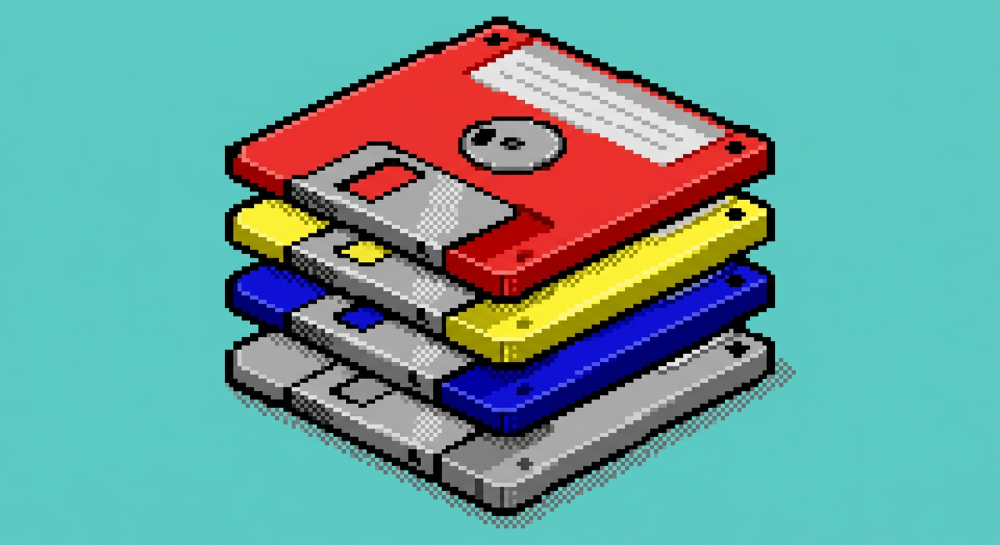
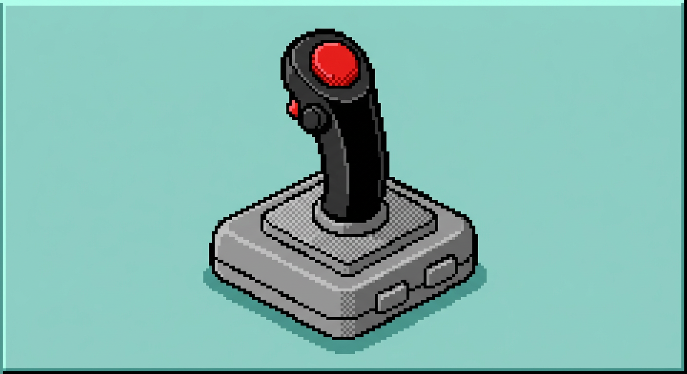
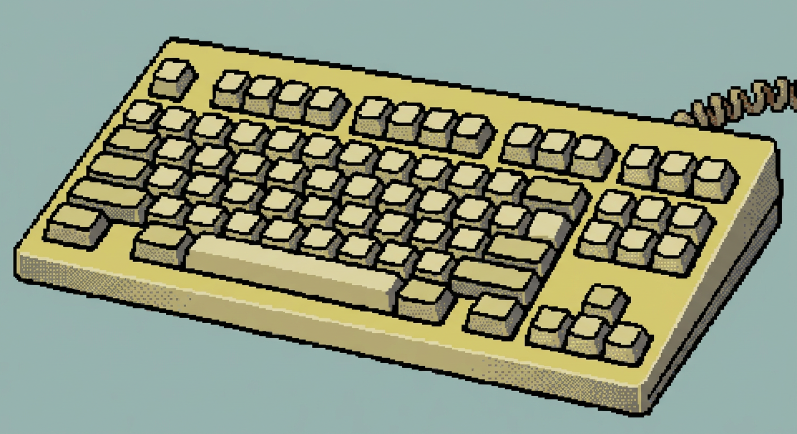

<div align="center">

# retro-kit-ui

### Retro interfaces for the modern web

React components inspired by **Windows 3.1** and **Mac System 7**.
Build forms, dashboards, product cards, and complete interface blocks with the personality of classic desktop software.

[](./packages/retro-ui)
[](./packages/retro-ui)
[](https://www.typescriptlang.org/)

<br />

[Explore the gallery](https://retro-kit-ui.vercel.app) · [View the components](./packages/retro-ui) · [Contribute](#contributing)

</div>

---

## `C:\RETROKIT>`

retro-kit-ui is a collection of reusable components and interface blocks for building products with an authentic retro identity, while keeping React, TypeScript, and accessibility at the core.

It includes two visual languages:

| Kit | Inspiration | Best for |
| --- | --- | --- |
| **Windows 3.1** | Navy blue, gray surfaces, bevels, and pixel UI | Applications, tools, and dashboards |
| **Mac System 7** | Black and white, compact windows, and 1-bit controls | Editorial interfaces and nostalgic experiences |

## Sample gallery

The repository also includes ready-to-use visual assets for retro product interfaces:

<table>
  <tr>
    <td align="center"></td>
    <td align="center"></td>
    <td align="center"></td>
  </tr>
  <tr>
    <td align="center"><strong>Floppy disks</strong></td>
    <td align="center"><strong>Joystick</strong></td>
    <td align="center"><strong>Keyboard</strong></td>
  </tr>
</table>

Explore the live showcase for interactive component previews and both retro themes:

**[Open the RetroKit showcase →](https://retro-kit-ui.vercel.app/showcase)**

## Included

- Basic controls: buttons, inputs, textarea, checkbox, radio, select, and switch.
- Navigation: menubar, tabs, dropdown menu, listbox, breadcrumbs, and pagination.
- Feedback: tooltip, toast, alert, progress, and separator.
- Data display: table, tree view, accordion, and scroll area.
- Ready-to-use blocks, including product cards and image galleries.
- Interactive previews for comparing both kits in the explorer.
- Packages for React and Web Components.

## Quick start

```bash
pnpm install
pnpm dev
```

Open `http://localhost:3000` to explore the component gallery.

### React

```tsx
import { RetroButton } from "@your-scope/retrokit-ui"

export function Example() {
  return <RetroButton>Run</RetroButton>
}
```

See the package documentation for installation and usage details:

- [`@your-scope/retrokit-ui`](./packages/retro-ui) — Windows 3.1 React components.
- [`@your-scope/retrokit-elements`](./packages/retro-elements) — framework-agnostic Web Components.

## Visual philosophy

retro-kit-ui does not try to smooth out the past. It keeps sharp borders, clear hierarchy, strong contrast, and recognizable controls. Every detail is designed to feel like a real desktop application from the 1990s while working correctly in a modern interface.

## Project structure

```text
components/
├── retro-ui/       # Windows 3.1 React kit
├── mac-ui/         # Mac System 7 React kit
└── showcase/       # Explorer and interactive demos

packages/
├── retro-ui/       # React package
└── retro-elements/ # Web Components package
```

## Contributing

Contributions are welcome. Before opening a pull request:

1. Create a descriptive branch for your change.
2. Preserve the visual language and patterns of the relevant kit.
3. Add or update the component preview.
4. Run the project checks:

```bash
pnpm packages:check
pnpm build
```

For new ideas and open tasks, see [`PENDING.md`](./PENDING.md).

## License

See the license files included with each package.

<div align="center">

[](https://github.com/poliedro-69/retro-kit-ui)

</div>
